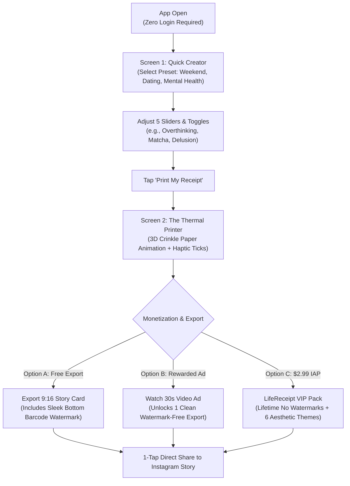

# LifeReceipt: Aesthetic Receipt Maker
## MVP Specification & 3-Day Rapid Launch Plan

---

### 1. Executive Summary & Value Proposition
* **App Name:** `LifeReceipt: Aesthetic Receipt Maker`
* **Subtitle:** `Weekly Mood & Spending Wrap`
* **Category:** Entertainment / Photo & Video
* **Target Audience:** Gen-Z & Millennials (US, UK, CA, AU) who share aesthetic dumps and self-deprecating memes on Instagram Stories and TikTok.
* **Core Value:** Turns emotional expenses and lifestyle habits into an ultra-realistic 3D thermal receipt in under 20 seconds.
* **Marginal Cost:** **$0.00 / user** (100% on-device local rendering, zero external AI API costs).

---

### 2. App Architecture & User Journey



---

### 3. Screen-by-Screen Specifications

#### Screen 1: The Quick Creator (Input Matrix)
* **Presets Bar (Horizontal Pills):**
  * 🍸 *The Weekend Wrap*
  * 💔 *The Situationship Audit*
  * 🧠 *Mental Breakdown & Chill*
  * ☕ *The Caffeine Addiction*
  * ✈️ *Vacation Mode*
  * ✏️ *Custom (Type your own line items)*
* **Interactive Line-Item Inputs:**
  * 5 pre-populated relatable items with steppers (`-` / `+` or slider `1-10`):
    * *Overthinking 2 AM text messages* (Qty: 3)
    * *Iced Vanilla Oat Milk Lattes* (Qty: 6)
    * *Impulse Amazon purchases* (Qty: 2)
    * *Unsent drafts & notes app apologies* (Qty: 1)
    * *Delusion Tax* (Slider: 0% to 100%)
* **Primary Action Button:**
  * Large, tactile button: `🖨️ PRINT MY RECEIPT` (Triggers sound effect & haptic motor).

#### Screen 2: The Thermal Printer (The Viral Result)
* **Visual Presentation (9:16 Vertical Canvas):**
  * Canvas: Dark aesthetic gradient (`#121212` to `#1A1A1A`).
  * Receipt: Off-white thermal paper (`#F8F7F2`) with subtle wrinkle texture, torn top and bottom jagged edges.
  * Typography: Authentic monospaced dot-matrix font (`Courier Prime` or `Space Mono`).
  * Layout:
    ```text
    ============================================
                L I F E   R E C E I P T
             STORE #404 • SUNDAY SUMMARY
    ============================================
    CASHIER: YOUR OVERTHINKING BRAIN
    DATE: NOV 07, 2026   TIME: 03:42 AM
    --------------------------------------------
    QTY  ITEM                              PRICE
    03   Overthinking 2am text messages   $99.00
    06   Iced Vanilla Oat Milk Lattes     $42.00
    02   Impulse Amazon purchases        $120.00
    01   Unsent Notes App apologies       $50.00
    14   Hours staring at ceiling           FREE
    --------------------------------------------
    SUBTOTAL:                            $311.00
    DELUSION TAX (+35%):                 $108.85
    TOTAL EMOTIONAL DAMAGE:              $419.85
    --------------------------------------------
    OVERALL VIBE:            CHAOTIC NEUTRAL
    CARD: ************2026   AUTH: SAVAGE_AI
    ============================================
    ||| | ||||| || |||||||| | |||| ||| |||||| ||
       SCAN FOR YOUR RECEIPT • GET LIFERECEIPT
    ============================================
    ```
* **Interactive Sharing Controls (Floating Bottom Dock):**
  * `[🟣 Share to Instagram Story]` (1-tap native sticker share).
  * `[💾 Save High-Res Image]` (Saves to photo library).
  * `[🎨 Change Paper Theme]` (Triggers paywall preview).

---

### 4. Monetization & Paywall Integration

#### 1. Free Tier (Watermarked)
* Every free export contains the bottom barcode and text:  
  `||| | ||||| || |||||||| | |||| ||| |||||| ||`  
  `SCAN FOR YOUR RECEIPT • GET LIFERECEIPT ON APP STORE`
* Placed so that if cropped, the receipt loses its authentic bottom tear and looks broken.

#### 2. Rewarded Video Ad ($35–$50 US eCPM)
* Trigger: User taps *"Remove Watermark for This Print"*.
* Modal: *"Watch 1 quick sponsor video to print this receipt watermark-free."*
* Behavior: After 30s ad completion, receipt is re-rendered without the bottom barcode.

#### 3. $2.99 One-Time IAP: "LifeReceipt VIP"
* Features Unlocked:
  * Remove all watermarks permanently.
  * 6 Aesthetic Paper Themes:
    1. *Classic Thermal (Free)*
    2. *Vintage Parchment (Aged 1800s paper)*
    3. *Glossy Pink POS (Y2K Aesthetic)*
    4. *Acid Neon Green (Cyber / Rave aesthetic)*
    5. *Obsidian Black & Gold (Luxury dark mode)*
    6. *Holographic Foil (Iridescent sheen)*
  * Custom store name & custom cashier name.
  * Unlimited 4K exports.

---

### 5. Technical Implementation Details

#### Recommended Stack:
* **Framework:** React Native with Expo SDK 52 (TypeScript).
* **View Capture:** `react-native-view-shot` to capture the receipt component as a high-resolution PNG.
* **Haptics & Audio:** `expo-haptics` (Heavy impact on button tap, continuous light selection ticks during printing) + `expo-av` (mechanical printer sound).
* **In-App Purchases:** `react-native-purchases` (RevenueCat SDK).
* **Ads Mediation:** `react-native-google-mobile-ads` (Google AdMob) or AppLovin MAX.
* **Instagram Story Sharing:** Native deep link schema:
  ```typescript
  import * as Linking from 'expo-linking';
  import * as FileSystem from 'expo-file-system';

  async function shareToInstagramStory(imageUri: string) {
    const url = `instagram-stories://share?source_application=com.yourname.lifereceipt`;
    // Pass image as pasteboard item or native intent
    const canOpen = await Linking.canOpenURL(url);
    if (canOpen) {
      // Native iOS pasteboard handover
    }
  }
  ```

---

### 6. The 3-Day Build Sprint

| Day | Focus | Checklist |
| :--- | :--- | :--- |
| **Day 1** | **UI & Thermal Receipt Renderer** | - Initialize Expo project (`npx create-expo-app lifereceipt`).<br/>- Build `ReceiptView` component with pixel-perfect dot-matrix styling.<br/>- Build input sliders and presets bar.<br/>- Test `react-native-view-shot` export at 3x scale. |
| **Day 2** | **Audio, Haptics & Theme Engine** | - Add printer sound effects and synchronized haptics.<br/>- Add 6 paper themes using CSS/SVG overlays.<br/>- Implement Instagram Story native share intent. |
| **Day 3** | **Monetization & App Store Assets** | - Configure RevenueCat for $2.99 Lifetime IAP.<br/>- Configure Google AdMob Rewarded Ad.<br/>- Render 3D app icon and 3 App Store screenshots.<br/>- Submit build to TestFlight / App Store Review. |

---

### 7. Launch TikTok / Reels Content Scripts

#### Video Script 1: The "Callout" Format
* **Visual:** POV looking down at hands holding phone on a coffee shop table.
* **On-Screen Text:** *"I let an app calculate my weekend emotional expenses and I feel attacked 💀"*
* **Action:** Tap "Print", watch the receipt slide out with sound, zoom in on `03 Overthinking 2am texts: $99.00` and `Delusion Tax: +35%`.
* **Audio:** Trending lo-fi or relatable TikTok sound.

#### Video Script 2: The "Couple / Situationship" Audit
* **Visual:** Handing the phone to a friend or partner: *"Fill in your numbers honestly."*
* **On-Screen Text:** *"Auditing our situationship with the receipt app..."*
* **Action:** Showing the final receipt with `Unsent Notes App apologies` and `Total Emotional Damage: $419.85`.
