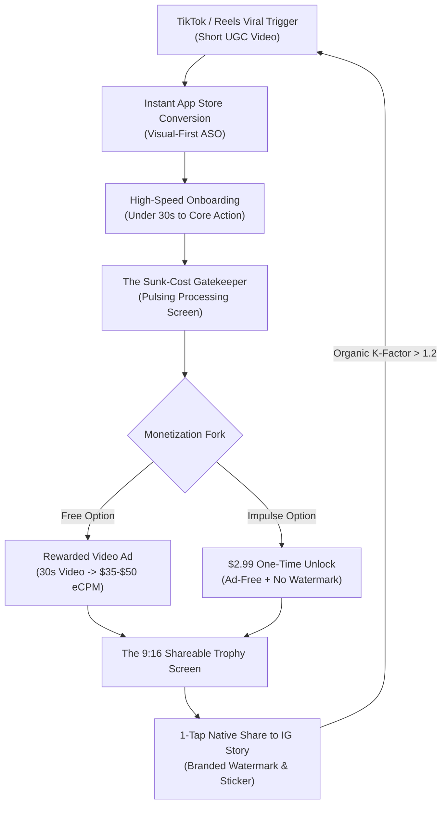
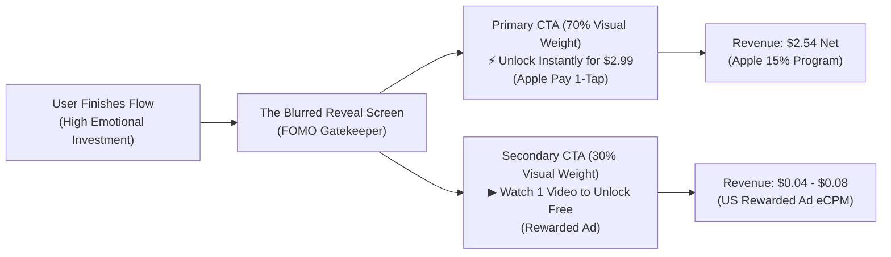
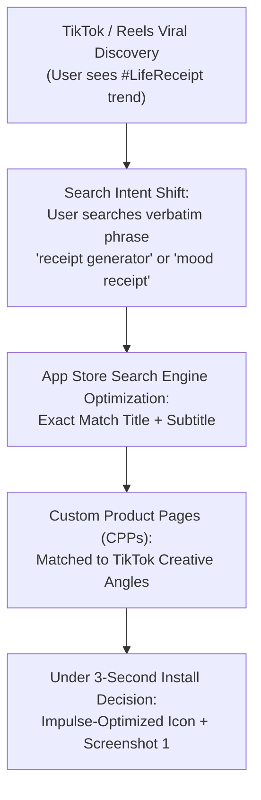

# The 2026 Viral Consumer Micro-App Portfolio Blueprint
## Scaling a Solo Indie Developer to $5,000/Month from Turkey

---

### Executive Strategic Thesis

In 2026, the mobile app ecosystem is bifurcated:
1. **Utility & Enterprise (The Red Ocean):** High-churn SaaS, complex B2B workflows, and heavy customer support requiring massive engineering and venture capital.
2. **Impulse Consumer Micro-Apps (The Blue Ocean for Solo Devs):** Single-utility, high-emotion, viral-driven applications built in 3 to 7 days using AI-accelerated code generation. These apps capitalize on boredom, vanity, curiosity, and the human desire for "Social Flex" on TikTok, Instagram Stories, and BeReal.

As a solo developer based in Turkey, your structural advantage is profound: **negligible living burn rate, zero team overhead, and global dollar-denominated revenue** through the Apple Small Business Program (15% commission tier) targeting Tier 1 GEOs (United States, United Kingdom, Canada, Australia, Japan).

To hit **$5,000/month consistently**, you do not need one unicorn app. You build an **asymmetric portfolio of 5 to 8 single-utility micro-apps**, where each app contributes $600 to $1,500/month via a hybrid engine of **high-eCPM Rewarded Video Ads** and **$1.99–$2.99 impulse one-time in-app purchases (IAPs)**.



---

## Phase 1: The Idea Factory (30 Specific App Ideas)

Every idea is designed to be built in under 7 days using modern 2026 AI toolchains (Cursor, v0, React Native Expo / Swift SwiftUI, CoreML, Supabase).

### Category 1: Curiosity & "Self-Discovery"

1. **AuraMatch (VibeScan AI)**
   *Concept*: Real-time camera scan that analyzes facial micro-expressions and lighting to assign an aura palette, vibe frequency, and the "toxic trait" you are currently radiating.
   *Hook*: *"Point the camera at your face for 3 seconds to find out what color vibe you're emitting—and the red flag everyone sees but won't tell you."*

2. **PastLife Mirror**
   *Concept*: Generates a photorealistic 1840s Victorian, Edo Japan, or Roman Empire portrait based on a single selfie, including cause of historical death and unresolved karmic debts.
   *Hook*: *"Upload a selfie to see your exact 19th-century self and the karmic debt you carried over into this lifetime."*

3. **Ex-Roast AI**
   *Concept*: Upload a screenshot of your ex’s text messages or dating profile; an unhinged AI conducts a psychological autopsy dissecting their toxic archetype.
   *Hook*: *"Drop a single screenshot of their texts and let AI explain why they're emotionally unavailable in 5 savage bullet points."*

4. **DelusionMeter**
   *Concept*: A 6-question quiz and spending/dating standard analyzer that calculates your exact mathematical "Delusion Index" (0–100%).
   *Hook*: *"Answer 6 rapid-fire questions to find out if you're 'manifesting' or just mathematically delusional."*

5. **FateMap (Soulmate Distance)**
   *Concept*: Computes your exact astrological coordinates to calculate the number of miles separating you from your destined partner and the year you will cross paths.
   *Hook*: *"Calculate the exact year, month, and distance in miles separating you from your destined soulmate right now."*

6. **VoiceVibe (Charisma & Pitch Analyzer)**
   *Concept*: User records a 5-second voice note; audio ML decodes their perceived charisma rating, subconscious stress level, and attractiveness score.
   *Hook*: *"Speak for 5 seconds to decode what strangers really think when they hear you talk."*

7. **RedFlag Radar (Friend Squad Edition)**
   *Concept*: Input your friend group's funniest offenses to produce an official FBI-style "Squad Threat Assessment Dossier" complete with mugshots and criminal charges.
   *Hook*: *"Input your group chat's funniest habits to generate an official criminal dossier of your squad's biggest red flags."*

8. **Parallel Universe You**
   *Concept*: Generates an alternate-timeline persona (avatar, job title, salary, aesthetic) showing what your life looks like in Universe #404 where you made that one different life choice.
   *Hook*: *"See what your lifestyle, style, and salary look like right now in the parallel universe where you never changed your major."*

9. **PetPsychic (Internal Subtitles)**
   *Concept*: Scan your cat or dog with the camera; AI generates their satirical internal monologue in a snarky British or Brooklyn accent with animated subtitles.
   *Hook*: *"Scan your pet with the camera to reveal the brutal thoughts they have about your life choices right now."*

10. **Anti-Horoscope (AstroRival)**
    *Concept*: Unlike soft astrology apps, this generates your weekly "Anti-Horoscope"—which zodiac sign is actively plotting against you, who will betray you, and your worst astrological flaw.
    *Hook*: *"The only astrology app that skips spiritual fluff and tells you which zodiac sign is plotting your downfall this week."*

---

### Category 2: "Social Flex" & Aesthetics

11. **PassportFlex (ScratchMap 3D)**
    *Concept*: A dynamic, hyper-clean 3D dark-mode globe where users tap cities visited to generate a luxury "Global Citizen" black card showing percentage of earth explored and passport rarity score.
    *Hook*: *"Tap every city you've visited to generate an ultra-aesthetic 3D passport card that proves you travel more than your followers."*

12. **LifeReceipt (Weekly Mood & Expense Wrap)**
    *Concept*: Converts your week, relationship, or vacation into an ultra-realistic 3D thermal receipt printed with line items like "3x Overthinking", "2x Iced Matcha", and "1x Unsent 2 AM Text".
    *Hook*: *"Print an ultra-realistic thermal receipt of your emotional expenses from this weekend to share on your story."*

13. **Monthly Moodboard (YearWrap 365)**
    *Concept*: Connects to the photo library or camera roll to automatically curate and generate a Vogue-style high-fashion editorial collage of the past 30 days in 1 tap.
    *Hook*: *"Transform your chaotic camera roll from this month into a sleek Vogue-style editorial summary in 3 seconds."*

14. **GlowLock (Neo-Brutalist Widgets)**
    *Concept*: High-aesthetic, minimalist lock-screen widgets featuring Bauhaus battery dials, typography counters, and cryptic daily fortune quotes.
    *Hook*: *"Give your lock screen a $1,000 Scandinavian design agency makeover with zero configuration."*

15. **FlightPath (SkyFlex 3D)**
    *Concept*: Enter an airline flight number to generate a Top-Gun style 3D cockpit trajectory animation with speed, altitude, and sunset clouds to post 5 minutes before departure.
    *Hook*: *"Turn your boring flight number into a luxury airline pilot animation ready for your IG story before takeoff."*

16. **ScreenTime Shame (Detox Poster)**
    *Concept*: Takes your iOS screen time screenshot and transforms it into an ironic, high-fashion Swiss typography poster ("Surviving on 9 hours of screen time and pure anxiety").
    *Hook*: *"Generate a high-fashion typographic poster of your screen time that makes phone addiction look like high art."*

17. **BatteryTwin (Partner Widget)**
    *Concept*: Peer-to-peer widget showing your partner's or best friend's live battery percentage, distance away, and a live 1-word mood status in a neo-brutalist widget.
    *Hook*: *"The aesthetic lock-screen widget that lets you and your partner check each other's battery life without asking 'are you home yet?'"*

18. **PretentiousMeter (TasteAudit)**
    *Concept*: Input your top 5 favorite movies, albums, or books to generate an official "Pretentious Taste Index" card and an acrylic museum display artifact.
    *Hook*: *"Find out how insufferably pretentious your media taste is on a scale from 1 to 100 with an official museum card."*

19. **FitVault (3D Sneaker & Outfit Showcase)**
    *Concept*: AI automatically clips backgrounds from sneaker and outfit photos, arranging them into an interactive floating 3D showroom shelf.
    *Hook*: *"Turn photos of your sneaker collection into a floating 3D hypebeast gallery ready to flex on Reels."*

20. **CoffeePass (Artisanal Cafe Passport)**
    *Concept*: Digital vintage embossed loyalty stamp card for coffee lovers to log their cortados, flat whites, and pour-overs, generating an aesthetic "Caffeine Connoisseur" certificate.
    *Hook*: *"Track your third-wave coffee obsession on a vintage cafe stamp card designed specifically for your story."*

---

### Category 3: Party, Icebreakers & Casual Fun

21. **HotSeat (Group Roaster)**
    *Concept*: Pass-the-phone group game where the device reads aloud tailored, brutal prompts (*"Who in this circle would accidentally join a financial cult?"*) and everyone points on the count of 3.
    *Hook*: *"The pass-the-phone party game that exposes what your friends actually think of you in under 60 seconds."*

22. **Sip Or Spill (Biometric Truth Detection)**
    *Concept*: High-stakes party drinking game: hold your thumb against the screen to 'scan' your pulse while answering an unhinged question; if you hesitate, an alarm blares and you drink.
    *Hook*: *"Put your thumb on the scanner and answer the question out loud—if you hesitate, the siren blares and you drink."*

23. **FoodRoulette (10-Second Craving Bracket)**
    *Concept*: Solves couple or group dinner paralysis through a sudden-death Tinder-style elimination tournament with strict veto rules.
    *Hook*: *"End the 45-minute 'I don't care, you pick' dinner argument with a 10-second sudden death tournament."*

24. **DrunkDial Gatekeeper (Sobriety Lock)**
    *Concept*: Activates automatically after 11 PM: forces the user to pass ridiculous cognitive tests (solve 3 math riddles, type your ex's name backward without typo) before opening messaging apps.
    *Hook*: *"A mock sobriety test on your phone that prevents you from sending that humiliating 2 AM text message."*

25. **AccentSwap (Brainrot & Posh Voice AI)**
    *Concept*: 1-tap voice transformer converting any recorded speech into 2026 trending internet archetypes: 1920s Noir Detective, British Duke, Italian Mobster, or Deadpan AI Narrator.
    *Hook*: *"Say anything into the mic and hear it instantly transformed into an aristocratic billionaire complaining about modern life."*

26. **WouldYouRather: Extreme Dilemmas**
    *Concept*: Unhinged moral and social dilemmas displaying real-time global live vote percentages ticking up in second-by-second animations.
    *Hook*: *"Vote on moral dilemmas so unhinged you'll immediately screenshot the global stats to argue with your friends."*

27. **ConspiracyWheel**
    *Concept*: Spin a neon wheel that links two random mundane subjects to generate a shockingly coherent, fake conspiracy theory complete with fake newspaper clippings.
    *Hook*: *"Generate a terrifyingly plausible conspiracy theory about any two random objects in your room to debate at 3 AM."*

28. **RedFlag vs GreenFlag Swiper**
    *Concept*: Fast-paced swipe game for couples or new daters: swipe through 30 controversial habits to calculate your "Toxic Compatibility Score".
    *Hook*: *"Swipe through 20 controversial dating habits to see if you and your crush are compatible or completely doomed."*

29. **ShockPointer (Finger Roulette)**
    *Concept*: 2 to 8 people place their fingers on the glass; after a suspenseful 5-second countdown, neon lightning shocks one finger to choose who pays the bill or takes the dare.
    *Hook*: *"Everyone puts their finger on the screen—the phone chooses who pays the bill or takes the dare with a neon shock."*

30. **RoastMyRoom (AI Interior Critic)**
    *Concept*: Snap a photo of your messy bedroom, unorganized desk, or fridge; a British-accented AI savagely roasts your lifestyle choices in 15 seconds.
    *Hook*: *"Take a photo of your bedroom and let AI brutally dismantle your life choices in a Gordon Ramsay tone."*

---

## Phase 2: Viral Loop Engineering (Top 5 Selected Ideas)

To guarantee a viral coefficient ($K > 1$), every step in the user journey must lead frictionless to an external share. Here are the 5 highest-potential concepts engineered for zero-cost distribution:

```
Viral Coefficient Formula:
K = i × c
where:
i = Number of invites/shares per user
c = Conversion rate of each share into a new app download
Target: K > 1.25 for explosive organic growth
```

---

### 1. LifeReceipt (Weekly Mood & Expense Wrap)

#### The Zero-Cost Viral Loop
1. **Trigger:** User sees a TikTok of someone printing an aesthetic thermal receipt detailing their toxic weekend expenses.
2. **Onboarding:** Zero login. User selects 5 emotional categories (Overthinking, Coffee, Retail Therapy, Regrets, Screen Time) and slides intensity bars (1–10).
3. **The Reveal:** A 3D thermal receipt animation slides out of an on-screen printer with authentic paper-crinkle haptics.
4. **The Incentive:** Receipts are funny, self-deprecating, and ultra-aesthetic. It serves as an ironic status symbol.
5. **The Share:** 1-tap "Share to Instagram Story" automatically pushes the pre-formatted 9:16 asset directly into Instagram Stories without saving to camera roll first.

#### End-Result Screen Layout (9:16 Story Canvas)
- **Background:** Moody deep-charcoal gradient (`#121212`) with soft vignette.
- **Centerpiece:** A crinkled off-white thermal paper receipt with jagged torn edges.
- **Typography:** Authentic thermal dot-matrix monospace (`Courier Prime` or custom bitmap font).
- **Line Items:**
  ```text
  ********************************************
             L I F E   R E C E I P T
               WEEK ENDING: SUNDAY
  ********************************************
  QTY  ITEM                              TOTAL
  03   Overthinking 2am text messages   $99.00
  07   Iced Oat Vanilla Lattes           $49.00
  01   Impulse Online Purchases         $140.00
  14   Hours Staring at Ceiling           FREE
  --------------------------------------------
  SUBTOTAL:                              100%
  DELUSION TAX:                          +25%
  OVERALL VIBE:            CHAOTIC NEUTRAL
  ********************************************
  ```
- **Watermark & Attribution:** At the bottom of the receipt is a scannable QR Code and barcode labeled:  
  `SCAN TO GET YOUR RECEIPT • GET LIFERECEIPT ON APP STORE`  
  *(Positioned directly above the bottom footer so cropping it cuts off the barcode and ruins the realistic aesthetic).*

---

### 2. PastLife Mirror (Historical Portrait & Karmic Death)

#### The Zero-Cost Viral Loop
1. **Trigger:** TikTok creator shows selfie $\rightarrow$ 1-second transition to a haunting 1840s portrait $\rightarrow$ shows hilarious cause of death.
2. **Onboarding:** Upload single selfie $\rightarrow$ select gender/era preference $\rightarrow$ 4-second "historical facial geometry scanning" animation.
3. **The Reveal:** An antique gilded picture frame holding an oil-painting portrait of their past self with historical metadata.
4. **The Incentive:** Pure curiosity and vanity flex. Users are eager to show off how attractive, aristocratic, or ridiculously tragic they were in 1840.

#### End-Result Screen Layout (9:16 Story Canvas)
- **Visuals:** Heavy baroque golden picture frame rendered in photorealistic 3D.
- **Portrait:** Sepia-tinted or oil-textured painting matching the user's facial proportions.
- **Metadata Card (Bottom 30%):**
  - **Name:** *Baroness Eleanor von Brandt (1812–1847)*
  - **Cause of Death:** *Danced for 36 hours straight at a royal masquerade, collapsed into a fountain.*
  - **Unfinished Karma:** *Still owes someone 40 gold coins.*
- **Watermark & Attribution:** Elegant gold embossed seal in the bottom right corner:  
  `🏛️ PastLife Mirror • App Store`  
  *(Watermark matches the antique frame aesthetic so users feel no desire to crop it).*

---

### 3. HotSeat (Pass-the-Phone Social Roaster)

#### The Zero-Cost Viral Loop
1. **Trigger:** Group of college students or friends laughing hysterically in a living room passing the phone around, captured on TikTok.
2. **Onboarding:** Add player names (3–10 players) $\rightarrow$ select deck ("Brutal Friendships", "Dating Secrets", "Too Far").
3. **The Reveal:** At the end of 15 rounds, the app generates the "HotSeat Squad Hall of Fame"—a brutally honest breakdown of who was voted most toxic, most likely to end up in jail, and biggest fake friend.
4. **The Incentive:** Peer validation and group chat bragging rights. Every member screenshots the graphic to post on their close-friends story.

#### End-Result Screen Layout (9:16 Story Canvas)
- **Style:** Neo-brutalist acid green (`#CCFF00`) and pitch black (`#000000`).
- **Header:** Heavy condensed sans-serif: *"OFFICIAL SQUAD ROAST REPORT"*.
- **Player Badges:**
  - 👑 **Most Dangerous Habit:** *Sarah (Voted by 83%)*
  - 🚩 **Biggest Walking Red Flag:** *Alex (Unanimous)*
  - 💸 **Will Fake Their Own Wealth:** *Marcus (91%)*
- **Watermark & Attribution:** High-contrast bottom banner:  
  `🔥 Play with your friends: Search "HotSeat App" on iOS`

---

### 4. PassportFlex 3D (Interactive Luxury Scratch Globe)

#### The Zero-Cost Viral Loop
1. **Trigger:** Reels video showing a gorgeous 3D matte-black globe spinning with glowing gold pins in Paris, Tokyo, and New York.
2. **Onboarding:** Tap any country or international airport visited $\rightarrow$ instantly rendered in real-time Metal 3D.
3. **The Reveal:** A sleek "Centurion-style" travel passport card featuring passport power score, total nautical miles, and percentage of the world conquered.
4. **The Incentive:** Unadulterated travel flex. In 2026, Gen-Z and Millennials pride themselves on travel badges.

#### End-Result Screen Layout (9:16 Story Canvas)
- **Style:** Matte-black luxury card with subtle holographic foil reflections.
- **Globe Asset:** 3D rendered spinning earth asset with illuminated golden paths connecting visited hubs.
- **Stats Display:**
  - **Countries Visited:** `24 / 195` (Top 4.2% of Travelers)
  - **Air Miles Logged:** `84,210 NM`
  - **Passport Status:** `BLACK OBSIDIAN TIER`
- **Watermark & Attribution:** Subtle laser-etched font on card border:  
  `MINTED ON PASSPORTFLEX 3D • APP STORE`

---

### 5. RoastMyRoom (AI Interior Critic)

#### The Zero-Cost Viral Loop
1. **Trigger:** POV video: *"I asked AI to roast my boyfriend's apartment and it told him his mattress on the floor is a biohazard."*
2. **Onboarding:** Point camera at room $\rightarrow$ tap shutter button $\rightarrow$ 3 seconds of soundwave analysis.
3. **The Reveal:** A Gordon Ramsay-style voice speaks the roast aloud, accompanied by animated red marker circles drawn directly over messy items in the photo.
4. **The Incentive:** Comedy and outrage. Users share it to mock their roommates, boyfriends, or show off their self-awareness.

#### End-Result Screen Layout (9:16 Story Canvas)
- **Visuals:** The user's original bedroom photo with hand-drawn red circles identifying offenses (e.g., clothes chair, unmade bed, cable nest).
- **HUD Overlay:** Night-vision style HUD with a giant score: `LIVABILITY RATING: 2.1 / 10`.
- **Verdict Text:** *"This room smells like cold pizza, unfulfilled potential, and chronic procrastination."*
- **Watermark & Attribution:** Branded crime-scene tape banner across bottom:  
  `⚠️ ROASTED BY ROASTMYROOM AI • DOWNLOAD FREE`

---

## Phase 3: Impulse Monetization Strategy

### Why Novelty Apps Require an "Impulse Playbook"
Novelty and curiosity apps have a distinct consumer behavior profile:
- **Low 30-Day Retention (3–8%):** Users do not open these apps every day for 6 months.
- **Instant High-Intensity Engagement:** The first session is intensely emotional (laughter, vanity, shock).
- **Subscription Resistance:** Users instantly cancel or refund $9.99/week subscriptions for novelty tools because they realize they only needed it once.

**The Solution:** The **Dual-Engine Hybrid Monetization Model**:
1. **Rewarded Ads (High Volume, Zero Resistance):** Converts 100% of non-paying users into ad impressions.
2. **$1.99–$2.99 One-Time Micro-IAPs (High Conversion, Zero Friction):** Instant Apple Pay impulse unlock for clean aesthetics, speed, and status.



---

### 1. When to Use Rewarded Ads vs. $2.99 One-Time Purchases

| Monetization Mechanic | Best Used For | Psychological Trigger | Target Benchmark |
| :--- | :--- | :--- | :--- |
| **Rewarded Video Ad (30s)** | Unlocking additional scans, revealing locked quiz results, rerolling a roast. | "I don't want to pay cash, 30 seconds of my attention is free." | 70–85% completion rate; \$35–\$55 US eCPM |
| **$2.99 Lifetime / Instant Unlock** | Removing watermarks, exporting in 4K HD, bypassing all future ads, unlocking "Uncensored / Explicit" decks. | "I want to post this aesthetic story right now without looking cheap with a watermark." | 2.5–5.0% conversion of active sessions |
| **$0.99 Consumable "Token Packs"** | 5 Extra Historical Portraits or 10 Voice Clones (when AI API cost exists). | Micro-commitment; feels smaller than a coffee. | 1.0–2.0% repeat purchase |

---

### 2. Designing the "Reveal Gatekeeper" FOMO Paywall UX

The peak conversion moment in a novelty app is the **3 seconds immediately preceding the big reveal**. Do not put the paywall at app launch. Place it after the user has invested effort.

#### Step-by-Step Gatekeeper Anatomy:
1. **The Sunk-Cost Investment:** The user answers 5 personal questions or uploads their selfie. They have now spent 30 seconds of their life.
2. **The "Calculating" Suspense Animation (3.5 Seconds):**  
   Display an active progress bar with micro-copy:  
   - *"Analyzing facial landmark symmetry..."* (35%)  
   - *"Matching with 19th-century historical archives..."* (78%)  
   - *"Generating your final karmic dossier..."* (99%)  
   *Use continuous subtle haptic vibrations (iPhone Taptic Engine) to make the calculation feel computationally heavy and real.*
3. **The Blurred Teaser Preview:**  
   The final result screen appears, but it is covered by a 14px Gaussian blur.  
   - The user can see shapes, colors, and the bold teaser:  
     `YOUR PAST LIFE CAUSE OF DEATH: [BLURRED TEXT - HIGHLY UNUSUAL]`
4. **The Dual-Action Button Stack:**  
   - **Primary Action (Top, Gold Gradient, Pulsing Glow):**  
     `⚡ UNLOCK FULL REVEAL INSTANTLY — $2.99`  
     *(Subtext: Apple Pay • One-time purchase • Ad-free forever)*
   - **Secondary Action (Bottom, Subtle Transparent Border):**  
     `▶ Or Watch 1 Quick Sponsor Video to Reveal (Free)`
5. **The Timed Exit Button:**  
   The top-right `✕` dismiss icon is hidden for the first 2.5 seconds, then fades in at 30% opacity. This eliminates reflex dismissals.

---

### 3. Financial Roadmap to $5,000/Month (Unit Economics from Turkey)

Operating as an indie developer in Turkey gives you access to the **Apple Small Business Program (15% commission)** rather than the standard 30%. 

To reach **$5,000 net/month**, your portfolio target is **$167 net per day**.

#### The 5-App Portfolio Distribution:
You build a portfolio of 5 focused apps. Each app needs to generate only **$33.40/day**.

```
Daily Revenue Goal per App: $34.00
---------------------------------------------------------------------
Ad Revenue Component:
- 800 Daily Active Users (DAU) per app (Tier 1 US/UK/CA focus)
- Average 2.5 Rewarded Video Ads watched per user = 2,000 ad impressions
- Average Tier 1 Rewarded eCPM: $35.00
- Ad Revenue per day: (2,000 / 1,000) × $35 = $70.00 Ad Gross
- Global blended eCPM (accounting for non-US traffic): ~$25.00 / day

IAP Component ($2.99 One-Time):
- 800 DAU × 1.8% conversion = 14.4 purchases / day
- 14.4 × $2.99 = $43.05 Gross
- Net after Apple 15% cut: $36.59 / day

Total Net Revenue Per App:
$25.00 (Ads) + $36.59 (IAP) = $61.59 / day ($1,847 / month)
```

**Portfolio Result:**  
With **3 performing apps** doing $1,500/mo and **2 baseline apps** doing $500/mo:  
$$\text{Total Monthly Net} = (3 \times \$1,500) + (2 \times \$500) = \mathbf{\$5,500/\text{month}}$$

#### Operating Infrastructure Costs:
- Apple Developer Account: $99/year ($8.25/mo)
- Server & Database: $0 (Local-first architecture + Supabase Free Tier)
- AI Inference: Edge-cached models (DeepSeek-V3, GPT-4o-mini, or CoreML on-device) $\approx$ $30/month per app
- **Net Profit Margin:** **> 92%**

---

## Phase 4: ASO & Launch Playbook

In 2026, App Store Optimization (ASO) for novelty entertainment apps is no longer about fighting for generic keywords like *"photo editor"* or *"game"*. It is about **TikTok-to-App Store Search Synergy**.

When a TikTok goes viral, users switch apps and type the exact colloquial name or visual concept into the App Store search bar.

---

### 1. 2026 ASO Trends for Novelty & Entertainment



#### Key Rules for 2026 App Store Discovery:
1. **Title & Subtitle Keyword Stacking:**  
   - Format: `[Brand Name]: [Exact TikTok Search Term]`
   - Example: `LifeReceipt: Aesthetic Receipt Maker`
   - Subtitle: `Weekly Mood & Weekend Wrap` (Use all 30 characters for high-intent search verbs).
2. **Custom Product Pages (CPPs):**  
   Create distinct App Store URLs for specific TikTok videos. If you run a video focused on "Relationship Roast", link to a CPP where Screenshot 1 shows the relationship roast layout.
3. **Keyword Field Allocation (100 Characters):**  
   Never repeat words from Title or Subtitle. Avoid spaces between commas.  
   *Example:* `astrology,ex,toxic,aura,vibe,personality,test,quiz,friends,party,truth,dare,drinking,game,stats`

---

### 2. Visual Conversion Masterclass: Icon & First 3 Screenshots

Gen-Z and Millennial impulse scrollers make the install decision in **under 2.8 seconds**. Your screenshots are not tutorials; they are **emotional trophies**.

#### The App Icon Formula
- **Single Focal Element:** One glossy, hyper-saturated 3D object on a dark or clean minimalist background.
- **No Text:** Never put English words on an app icon. It looks cluttered and unpolished.
- **Skeuo-Minimalism:** Matte finish, tactile textures (e.g., a glowing thermal paper roll, an antique gold picture frame, an acid-green neon lightning bolt).

#### Screenshot 1: The "Aha! Result" (Conversion Anchor)
- **Goal:** Show the exact viral payoff immediately.
- **Design:** Full-bleed 9:16 mock showing the crazy, funny, or aesthetic result.
- **Header Banner:** Big, bold, punchy headline (maximum 4 words):  
  `WHO WERE YOU IN 1840?` or `YOUR WEEKEND AS A RECEIPT`
- **Avoid:** Do not show onboarding, login buttons, or permissions screens.

#### Screenshot 2: The "Social Flex / Proof" (Ego Validation)
- **Goal:** Prove to the user that other people will care when they post it.
- **Design:** Show the graphic formatted inside an Instagram Story mock, with floating DM reaction emojis (🔥, 💀, 😭, "OMGGG WHERE DID U GET THIS??").
- **Header Banner:**  
  `READY FOR YOUR STORY IN 1-TAP`

#### Screenshot 3: The "Zero-Friction Simplicity"
- **Goal:** Overcome the friction objection (*"Is this going to make me take a 50-question quiz?"*).
- **Design:** Clean UI mockup showing a 3-second camera snapshot or a simple 3-question card swiper.
- **Header Banner:**  
  `SNAP A PHOTO. GET ROASTED.`

---

### 3. Rapid-Launch Sprint Checklist (From Zero to App Store in 7 Days)

| Timeline | Milestone | Key Deliverables & Actions |
| :--- | :--- | :--- |
| **Day 1** | **Concept & Viral Validation** | - Pick 1 idea from the Top 5.<br/>- Create a quick 10-second Figma mockup video.<br/>- Post on a fresh TikTok/Reels account to test initial view-to-comment ratio. |
| **Day 2** | **Core UI & Engine Scaffolding** | - Initialize React Native Expo or SwiftUI project.<br/>- Build the single core screen (Input $\rightarrow$ Reveal).<br/>- Integrate local-first logic or edge API. |
| **Day 3** | **Monetization & Share SDK Integration** | - Integrate RevenueCat for $2.99 IAP.<br/>- Integrate AppLovin MAX / Google AdMob for Rewarded Ads.<br/>- Implement native Instagram Story sticker share intent. |
| **Day 4** | **ASO Assets & Polish** | - Render 3D icon in Midjourney / Spline.<br/>- Generate 3 high-converting App Store screenshots.<br/>- Write Title, Subtitle, and 100-character keyword string. |
| **Day 5** | **App Store Submission** | - Build TestFlight archive.<br/>- Submit for App Store review with demo account and clear reviewer notes explaining the novelty/entertainment purpose. |
| **Day 6** | **The Organic Seed Batch** | - While in review, record 10 short TikToks/Reels (UGC-style, handheld, showing friend reactions).<br/>- Prepare captions and trending audio. |
| **Day 7** | **Launch & Iteration** | - App goes live $\rightarrow$ publish the 10 videos across 3 accounts.<br/>- Monitor App Store Connect downloads, ad impressions, and IAP conversion.<br/>- If metrics validate ($K > 1$, eCPM > $30), double down. If flat after 14 days, launch the next app in the portfolio. |

---

### The Turkey Indie Hacker Execution Advantage
As an indie hacker in Turkey targeting the US/global App Store:
- **Low Overhead Runway:** A $5,000/month recurring income provides immense leverage and financial freedom.
- **Velocity as Moat:** Do not spend 6 months perfecting an app. If an app does not pop organically within 3 weeks of TikTok seeding, keep it running for passive ad revenue and immediately launch the next concept.
- **Portfolio Compounding:** 5 apps generating an average of $35/day reaches the $5,000/month goal with zero outside funding, zero staff, and 100% equity.
